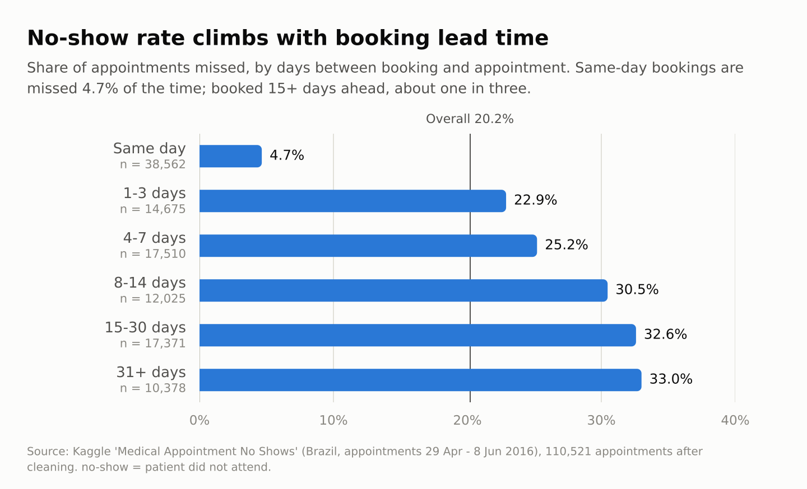
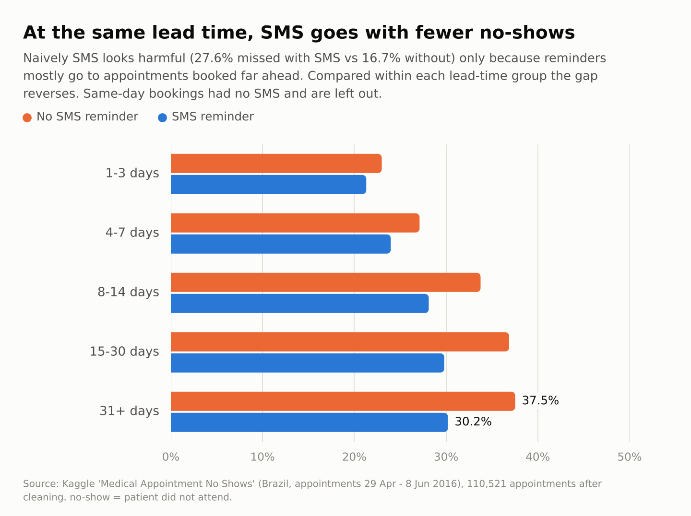
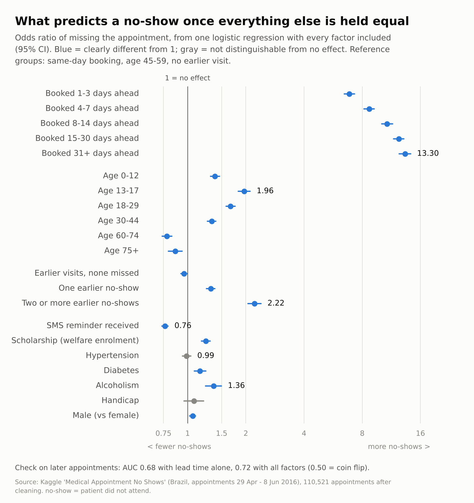

# Who misses medical appointments, and why? A SQL analysis of 110k bookings

**Question:** which factors actually predict whether a patient misses an appointment, and what should a clinic do about it?

**Data:** [Medical Appointment No Shows](https://www.kaggle.com/datasets/joniarroba/noshowappointments) (Kaggle). 110,527 appointments from Brazil, booked between Nov 2015 and Jun 2016, with appointment dates from 29 Apr to 8 Jun 2016. 110,521 remain after cleaning.

**Tools:** SQL (SQLite, including window functions) for cleaning and analysis, Python (pandas, statsmodels, scikit-learn, matplotlib) for the model and charts.

## Key findings

**Overall, 20.2% of appointments are missed** (22,314 of 110,521).

1. **Lead time is by far the strongest signal.** Same-day bookings are missed 4.7% of the time. Booked 15+ days ahead, about one in three (32.6% at 15-30 days, 33.0% at 31+). Same-day bookings are 35% of all appointments, which pulls the overall rate down.
2. **SMS reminders look harmful, but only because of who gets them.** Raw rates: 27.6% missed with an SMS vs 16.7% without. Reminders are almost only sent for appointments booked well ahead, which miss more anyway. Compared inside each lead-time group, patients with an SMS miss less (for example 30.2% vs 37.5% at 31+ days). After adjusting for everything else, the odds ratio is 0.76. This is an association in observational data, not proof that SMS causes the drop.
3. **A patient's own history matters.** Patients with two or more earlier no-shows miss 32.1% of the time, vs 18.9% for patients with earlier visits and none missed (adjusted odds ratio 2.2).
4. **Age matters, in a U-shape.** Teens (13-17) miss 26.6% and 18-29 miss 24.6%; 60-74 miss only 15.0%.
5. **Some "obvious" factors disappear once you control for the others.** Hypertension looks protective (17.3% vs 20.9% missed), but the effect is gone after adjustment (odds ratio 0.99, 95% CI 0.94-1.04): hypertensive patients are older, and age is what matters. The reverse happens for alcoholism: raw rates are identical (20.2% vs 20.2%), but after adjustment it carries a higher risk (odds ratio 1.36), because those patients skew older.
6. **Gender, weekday and handicap barely matter.** Gender differs by 0.4 points, weekday by 1.9 points, and the handicap effect is not distinguishable from zero.
7. **It is only moderately predictable.** A logistic regression trained on earlier appointments and tested on later ones reaches an AUC of 0.72 (0.68 with lead time alone; 0.50 is a coin flip). It is good for deciding who to remind, not for saying who will miss.





More charts: [age](charts/02_age.png), [patient history](charts/04_patient_history.png). Every chart has its numbers in `results/*.csv`.

### Ranking of factors (gap between highest and lowest group)

| Factor | Highest group | Lowest group | Gap (pp) |
|---|---|---|---|
| Lead time | 33.0% | 4.7% | 28.4 |
| Patient history | 32.1% | 18.9% | 13.3 |
| Neighbourhood | 28.9% | 15.8% | 13.1 |
| Age group | 26.6% | 15.0% | 11.6 |
| SMS received | 27.6% | 16.7% | 10.9 |
| Scholarship | 23.7% | 19.8% | 3.9 |
| Hypertension | 20.9% | 17.3% | 3.6 |
| Diabetes | 20.4% | 18.0% | 2.4 |
| Handicap | 20.2% | 18.1% | 2.1 |
| Weekday | 21.2% | 19.4% | 1.9 |
| Gender | 20.3% | 20.0% | 0.4 |
| Alcoholism | 20.2% | 20.2% | 0.0 |

This is the raw (one factor at a time) view from `sql/02_analysis.sql`, among groups with 1,000+ appointments. The SMS and hypertension rows show why it can mislead; see `03_model.py` for the adjusted view.

## What a clinic could do

- **Target reminders by booking lead time.** Appointments booked 8+ days ahead are missed about 30-33% of the time. Add a second reminder or a confirm/cancel request for these.
- **Call patients with two or more earlier no-shows** before the appointment. They are the clearest individual-level warning sign.
- **Run a proper test of SMS reminders** (randomly send or hold them) before claiming a benefit. The data here cannot separate the reminder from who was chosen to receive it.
- **Do not use chronic-condition flags such as hypertension as a no-show risk marker.** The raw gap is explained by age.
- **Look into the neighbourhoods with the highest rates** (for example Santos Dumont at 28.9%, Itararé at 26.3%) for access problems such as transport, but see the limitations below.

## How the analysis works

```
sql/01_clean.sql       clean table + buckets + patient history (window functions)
sql/02_analysis.sql    10 named queries: rates by lead time, age, SMS, history, neighbourhood, ...
run_analysis.py        loads the CSV into SQLite, runs both SQL files, writes results/*.csv
03_model.py            logistic regression (odds ratios) + time-based predictive check
04_charts.py           builds charts/*.png from results/
```

A taste of the SQL: patient history uses only appointments on **earlier days**, so there is no leakage from the appointment being predicted.

```sql
COUNT(*) OVER (
    PARTITION BY patient_id
    ORDER BY julianday(appointment_date)
    RANGE BETWEEN UNBOUNDED PRECEDING AND 1 PRECEDING
) AS prior_appointments
```

### Run it yourself

1. Download the CSV from the Kaggle link above (free account needed).
2. `pip install -r requirements.txt`
3. Run in order:

```
python run_analysis.py path/to/KaggleV2-May-2016.csv
python 03_model.py
python 04_charts.py
```

This also writes `data/appointments_clean.csv`, a clean table you can load into Power BI or Excel for a dashboard. The `data/` folder is not committed.

## Data cleaning decisions

- Fixed column typos (`Hipertension`, `Handcap`) and turned the `No-show` text into a 0/1 `no_show` (1 = did not attend).
- Dropped 6 rows: 1 with age -1, and 5 where the appointment date is before the booking date.
- Kept ages of 0 (3,539 genuine infants) and 7 rows above 100 (rare, not provably wrong).
- `Handcap` is 0-4 in the data, not a yes/no flag, so both the level and a 0/1 flag are kept.
- `AppointmentDay` has no time of day, so lead time is in whole days.
- No missing values and no duplicate appointments. 62,298 distinct patients make up the 110k appointments.

## Limitations

- **Observational data from one region over six weeks.** Findings may not carry over to other clinics or seasons.
- **Association, not causation**, especially for SMS reminders.
- **Patient history is truncated.** Only earlier appointments inside the six-week window are visible, so "no earlier visit" often means "none seen".
- **Confidence intervals are too narrow.** Many patients appear several times, and the model treats appointments as independent.
- **Neighbourhood and weekday are not in the regression**, so the neighbourhood differences may partly reflect different lead times or patient ages. This is the natural next step.
- **Scholarship** is a welfare-enrolment flag, so it is a proxy for socioeconomic situation, not an education measure.

## Data source

Kaggle dataset "Medical Appointment No Shows". The raw data is not included here; download it from Kaggle and follow its licence terms.
